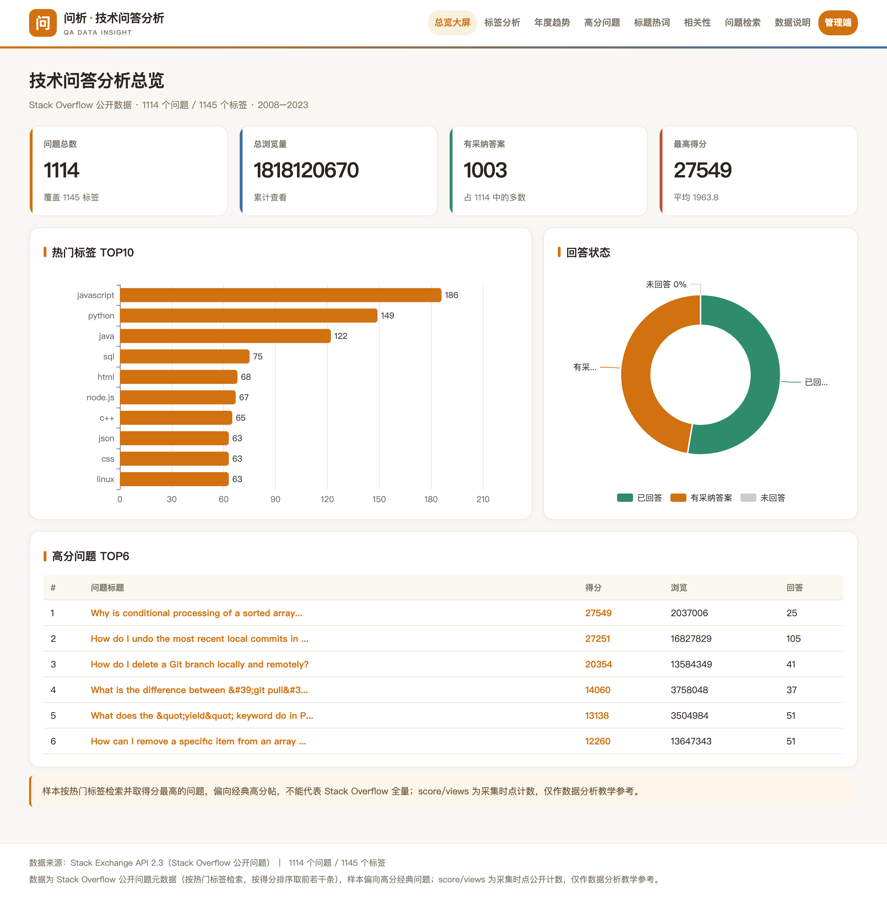
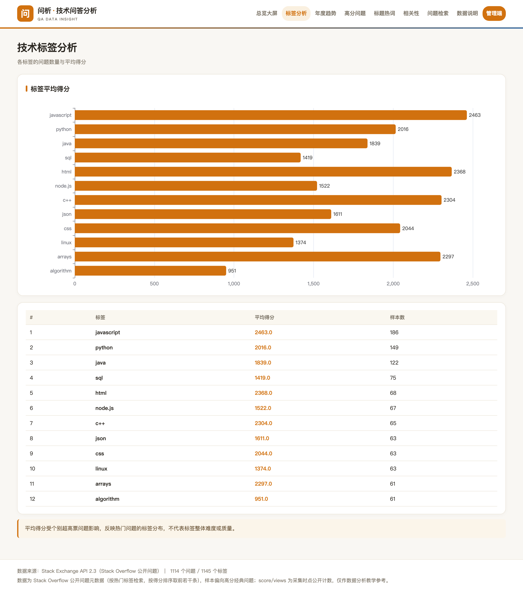
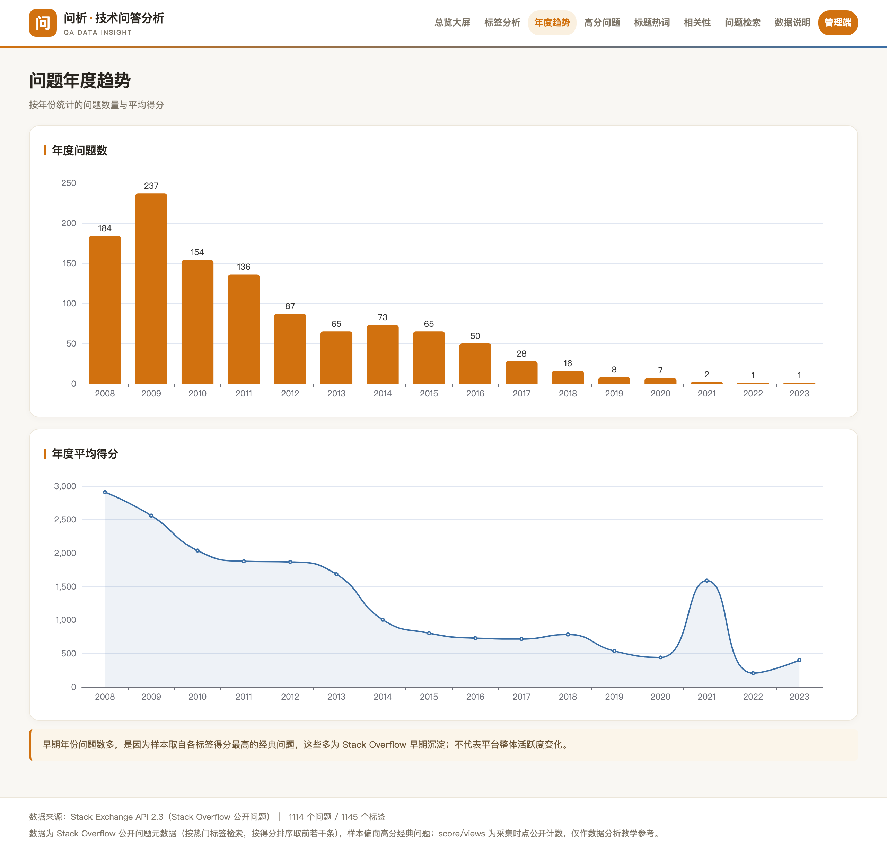
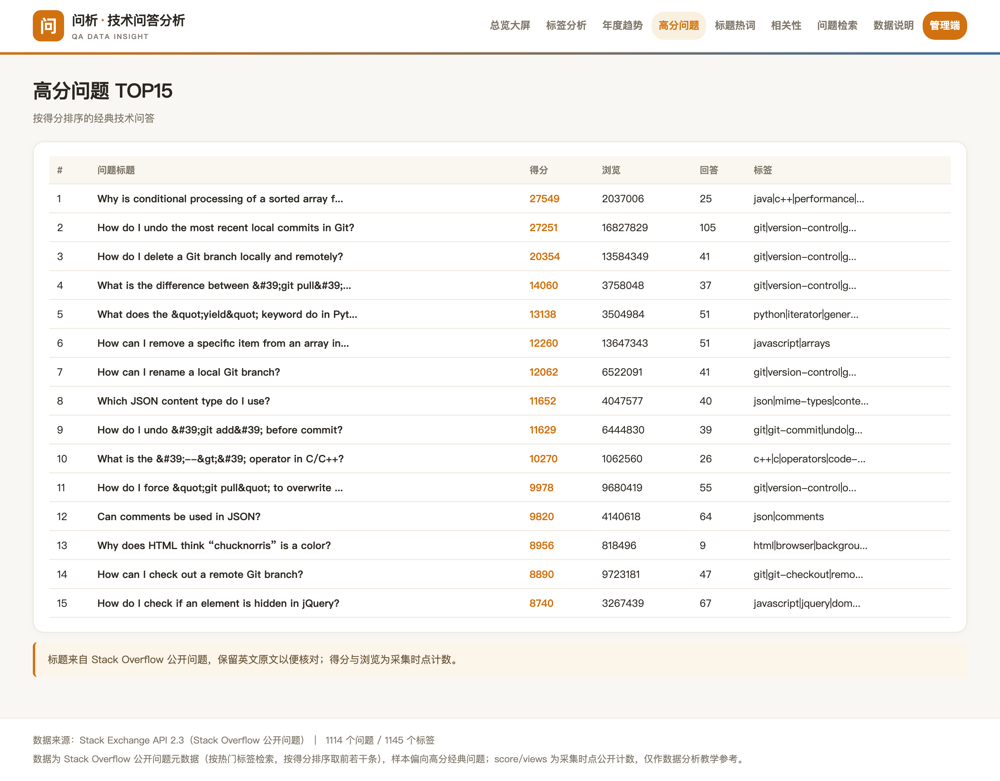
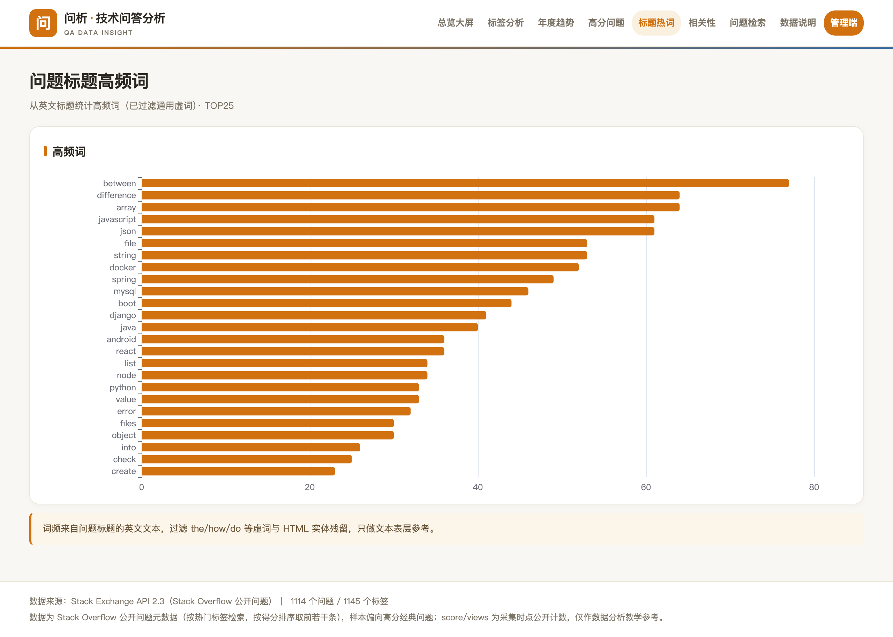
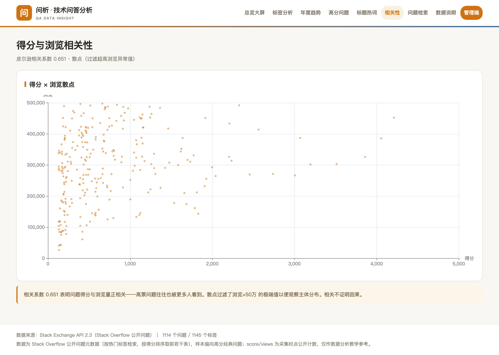

# 052 基于Stack Overflow公开数据的技术问答分析系统-设计展示

> **代码有偿获取 可接受定制 微信联系方式: csbysj2020 或 ACE2487，备注(BS)**

> **完整源码与全套文档 · 在线自助获取 >>> [https://mbd.pub/o/bread/YZaWmJhtaQ==](https://mbd.pub/o/bread/YZaWmJhtaQ==)**

> **成品页（功能介绍 / 更多选题）>>> [https://bishe.suilang.net/products/tech-qa-insight](https://bishe.suilang.net/products/tech-qa-insight)**

> 

> 

## 视频

> **点击查看 >>> [https://www.bilibili.com/video/BV1qbsB6PEZ4/](https://www.bilibili.com/video/BV1qbsB6PEZ4/)**

## 项目简介

真实采集 Stack Exchange API 公开数据，1114 个技术问题、1145 个标签、1818120670 次浏览（2008–2023）。按热门标签检索并应对配额，多维统计标签分布、年度趋势、高分问题排行、标题热词与得分-浏览相关性（r=0.651）；javascript 标签问题最多、最高得分 27549。8 个页面 ECharts 本地内置离线可用。样本偏向高分经典帖、相关不等于因果如实标注，只做数据分析教学参考。

Stack Overflow 公开 API 为研究技术问答生态提供了丰富元数据。

本项目设计并实现了一套基于 Stack Overflow 公开数据的技术问答分析系统：通过 Stack Exchange API 2.3 按 20 个热门标签检索采集 1114 个问题（2008–2023），结构化解析得分、浏览、回答数、标签与时间；多维统计标签分布、年度趋势、高分问题排行、标题热词与得分-浏览相关性（r=0.651），发现 javascript 标签问题最多、最高得分问题达 27549。

系统实现总览大屏、标签分析、年度趋势、高分问题、标题热词、相关性、问题检索与数据说明共 8 个页面，ECharts 本地内置、离线可用。

本仓库为**设计展示**：包含项目说明、技术架构、实验结果与运行截图；完整源码、任务书、开题报告、毕业论文与使用说明可通过上方链接自助获取，成品页可查看更多选题，也可联系微信咨询定制。

## 功能特性

1. 真实采集：Stack Exchange API 2.3 公开免登录，1114 问题 / 1145 标签 / 1818120670 浏览

2. 按标签检索：20 个热门标签，每标签取得分前 60 条，记录配额剩余

3. 标签分析：各标签问题数与平均得分，javascript 最多

4. 年度趋势：2008–2023 问题年份分布与平均分

5. 高分排行：得分最高经典问答 TOP15，最高分 27549

6. 标题热词：英文标题高频词 TOP25，过滤通用虚词

7. 相关性：得分与浏览皮尔逊系数 0.651，正相关

8. 数字单一来源：页面与论文读 data/stats.json，重跑三步即可同步

9. 诚实边界：样本偏高分经典帖、已回答与有采纳为包含关系、相关不等于因果均如实标注

## 技术架构

| 项目 | 说明 |
| --- | --- |
| 编程语言 | Python 3.8+ |
| Web 框架 | Django 4.2（默认 SQLite） |
| 统计计算 | NumPy + 标准库 |
| 前端 | Django 模板 + 本地 ECharts |
| 样本规模 | 1114 问题 / 1145 标签 / 16 年 |
| 运行端口 | http://127.0.0.1:8052 |
| 演示账号 | admin / admin123456 |

## 目录结构

以下为完整交付版的结构（本仓库仅作设计展示）：

```
tech-qa-insight/
├── analytics/
│   ├── __init__.py
│   └── build.py
├── crawler/
│   ├── __init__.py
│   └── fetch_stackoverflow.py
├── data/
│   ├── analysis/
│   │   ├── answer_status.json
│   │   ├── keywords.json
│   │   ├── overview.json
│   │   ├── scatter.json
│   │   ├── tag_score.json
│   │   ├── tags.json
│   │   ├── top_questions.json
│   │   └── years.json
│   ├── processed/
│   │   └── questions.csv
│   ├── raw/
│   │   ├── so_algorithm.json
│   │   ├── so_android.json
│   │   ├── so_arrays.json
│   │   ├── so_cpp.json
│   │   ├── so_css.json
│   │   ├── so_django.json
│   │   ├── so_docker.json
│   │   ├── so_git.json
│   │   ├── so_html.json
│   │   ├── so_java.json
│   │   ├── so_javascript.json
│   │   ├── so_json.json
│   │   ├── so_linux.json
│   │   ├── so_machine-learning.json
│   │   ├── so_mysql.json
│   │   ├── so_node_js.json
│   │   ├── so_python.json
│   │   ├── so_react.json
│   │   ├── so_spring-boot.json
│   │   └── so_sql.json
│   └── stats.json
├── stackscope/
│   ├── __init__.py
│   └── …
└── …
```

## 数据与实验结论

- 真实采集：Stack Exchange API 2.3 公开免登录，1114 问题 / 1145 标签 / 1818120670 浏览
- 按标签检索：20 个热门标签，每标签取得分前 60 条，记录配额剩余
- 年度趋势：2008–2023 问题年份分布与平均分
- 高分排行：得分最高经典问答 TOP15，最高分 27549

## 交付内容

1. 完整源码（Django + 采集器 + 分析引擎 + 8 页面）
2. 真实数据（raw JSON + CSV + SQLite）
3. 一键启动脚本
4. 任务书与开题报告（Word）
5. 毕业论文（Word 七章制）
6. 二次开发说明（Word+md）
7. 6 张截图 + 封面 + 演示视频

## 常见问题

**数据是爬的吗？能更新吗？**

是。crawler/fetch_stackoverflow.py 调 Stack Exchange API 采集，重跑采集→分析→入库即可更新。

**数据全吗？**

每个标签取得分前60条，样本偏向高分经典帖，不能代表平台全量，数据说明页有注明。

**已回答和有采纳什么关系？**

有采纳是已回答的子集，图中为包含关系非互斥分类。

**相关说明因果吗？**

不说明，散点与系数只揭示线性关联。

**能换 MySQL 吗？**

能。设 DB_ENGINE=mysql 及 DB_NAME/DB_USER/DB_PASSWORD 后 migrate 即可，默认 SQLite 免安装。

## 截图







